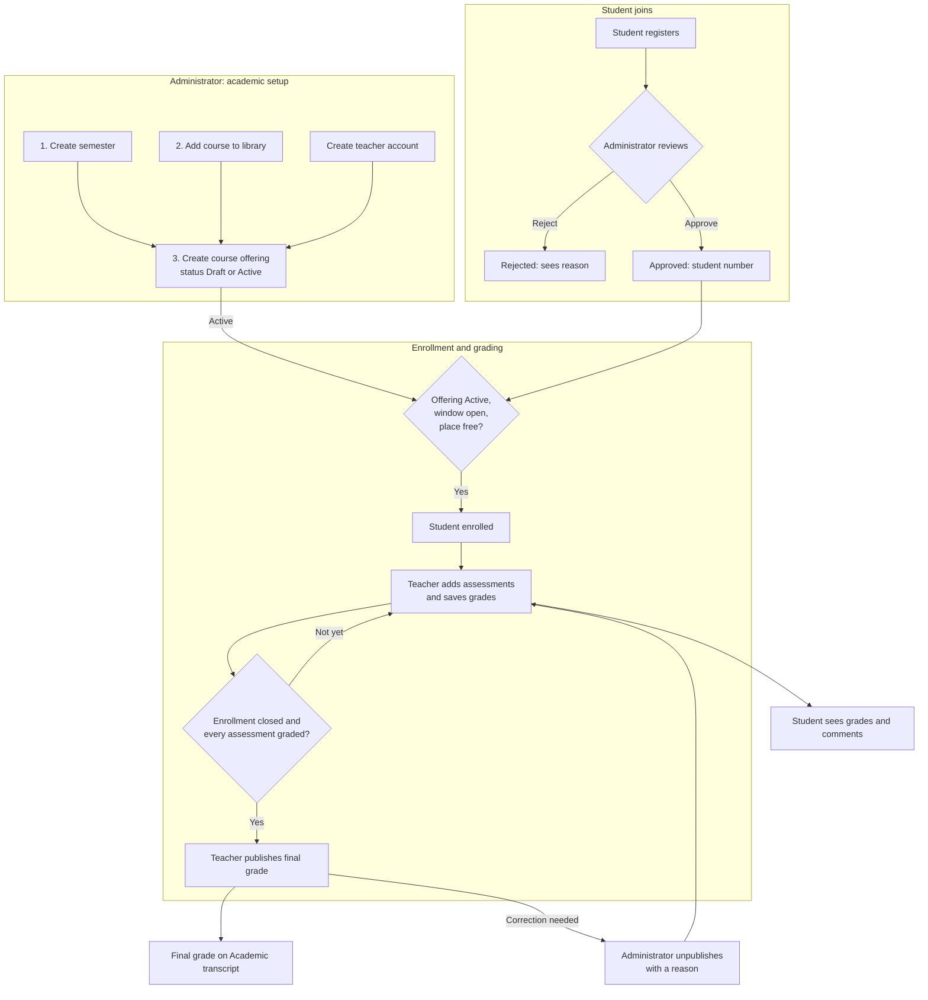
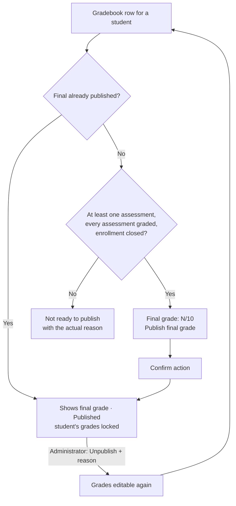

# Application Workflows

This document explains how the Campus Student Registration and Grade Management application works. It describes only behaviour implemented in the current code. Business rules are enforced in the service layer (`accounts/services.py`, `academics/services.py`, `grading/services.py`); the user interface explains them but never replaces them.

> **Viewing the diagrams:** GitHub renders Mermaid diagrams automatically. In VS Code, install the **Markdown Preview Mermaid Support** extension and open the preview (`Ctrl+Shift+V`).

## Roles

| Role | Main job | How the account is created |
|---|---|---|
| **Administrator** | Approves students, builds the academic structure, corrects mistakes | Command line only: `createsuperuser` or `seed_demo` |
| **Teacher** | Adds assessments, enters grades, publishes final grades for assigned offerings | By an administrator: **People & applications → + Create teacher** |
| **Student** | Enrolls in courses and follows grades and final results | Registers online, then waits for administrator approval |

Navigation after signing in:

| Role | Sidebar |
|---|---|
| Administrator | Overview · People & applications · Semesters · Course library · Course offerings · Audit history |
| Teacher | Overview · Assigned courses |
| Student (approved) | Overview · Course catalog · My courses · Academic transcript |
| Student (pending or rejected) | Overview · Application status (every student page redirects here) |

Every **Overview** page shows a **Your next step** banner with one concrete action, plus statistic cards that link to the matching list.

## Key terms

| Term | Meaning |
|---|---|
| **Semester** | A named teaching period with start and end dates. Every course offering belongs to one semester. |
| **Course** (Course library) | A permanent course description: code, title and description. It has no teacher, dates or students. |
| **Course offering** | One library course taught in one semester by one teacher, with a capacity and an enrollment window. Students enroll in offerings. |
| **Enrollment window** | The period between **Enrollment start** and **Enrollment end**. |
| **Assessment** | A graded piece of work in an offering. All assessments count equally. |
| **Grade** | A whole number from 1 to 10 for one student and one assessment, with an optional comment. |
| **Final grade** | The official result for one student in one offering: the average of all assessment grades, rounded half up (7.5 becomes 8). |

---

## 1. End-to-end flow

---

## 2. Student registration and approval

1. A visitor opens the login page and selects **Create a student account**. They enter first name, last name, email and password, then **Create student account →**. Registration cannot set a role or permissions.
2. The account is created as **Pending approval**, the student is signed in, and only **Application status** is available. No email is sent; the page explains that the student should refresh it.
3. The administrator opens **Overview → Review N applications →** (or **People & applications**, filter **Pending approval**) and chooses:
   - **Approve → Confirm action.** The student receives a permanent student number (`STU-` followed by six digits) and the full student workspace.
   - **Reject.** A written reason is required and is shown to the student on **Application status**, together with next steps. A rejected student can be approved later; they do not need to register again.
4. The confirmation pages list what each action does before it is confirmed.

Restrictions:

- Only administrators approve or reject. Only students go through approval.
- A student with academic history (any enrollment) cannot be rejected; they must be blocked instead.

### Blocking accounts

**People & applications → Block** (reason required) deactivates a teacher or student. The user is signed out on their next request and cannot sign in. Enrollments, grades and occupied places are kept, and a blocked teacher cannot be assigned to new offerings. **Unblock** (reason also required) restores access. Administrator accounts cannot be blocked. The reason is recorded in **Audit history** and is not shown to the user.

---

## 3. Academic setup: semester, course, offering

The three administrator pages show a **Step 1 of 3 → Step 3 of 3** strip in setup order.

| Step | Page | Fields | Rules |
|---|---|---|---|
| 1 | **Semesters → + Create semester** | Name, Start date, End date | Name is unique. End date cannot be before start date. A semester cannot be shortened so that it ends before an offering's enrollment closes. |
| 2 | **Course library → + Add course to library** | Code, Title, Description | Code is unique. |
| 3 | **Course offerings → + Create course offering** | Course, Semester, Teacher (section *Course and teacher*); Capacity, Enrollment start, Enrollment end (*Enrollment*); Status (*Visibility*) | See below. |

Course offering rules:

- One offering per course per semester.
- Only non-archived courses and semesters and only active teachers can be selected.
- Capacity is at least 1 and cannot be lowered below the current number of enrolled students.
- Enrollment end must be after enrollment start and on or before the semester's end date.
- **Draft** offerings are hidden from students and read-only for the teacher. **Active** offerings appear in the course catalog.
- Once an offering has enrollments or assessments, its course and semester cannot change and it cannot return to Draft.
- An offering cannot be edited while any of its final grades is published.

If a semester, a library course or an active teacher is missing, the offering list and form show a checklist of the missing prerequisites. The offering list shows places, the enrollment window (Open, Closed or Not open yet, with dates) and the status.

---

## 4. Enrollment and withdrawal

The **Course catalog** lists Active offerings in non-archived semesters. Each card shows one status:

| Status | Meaning |
|---|---|
| **You are enrolled** | The student has an active enrollment (shown first, whatever the other conditions) |
| **Enrollment closed** | The enrollment window is not open (closed or not yet open) |
| **Enrollment full** | The window is open but no place is left |
| **Open for enrollment** | The window is open and places are available |

Enrolling: **View course → Enroll in course → → Confirm action**. Enrollment is immediate when all of these are true: the student is approved, the offering is Active, its semester and course are not archived, the current time is inside the enrollment window, a place is free, and the student is not already enrolled. Capacity is protected against two students taking the last place at the same time.

Withdrawing: **Withdraw from course → Confirm action**. Allowed only while the enrollment window is open and before any grade or final grade exists for the student. Otherwise the course page explains why withdrawal is not available. Enrolling again later restores the original enrollment record.

---

## 5. Assessments and grading

The teacher opens **Assigned courses → Open gradebook**. The page shows the enrollment window and explains what is currently possible.

- **+ Add assessment**: Title, Description, Due date, Display order (lower numbers appear first). Assessments can be added, edited or deleted only while the offering is Active and its semester is not archived.
- Assessments are **locked** while any final grade in the offering is published; the gradebook then hides these actions and explains why.
- An assessment that already has grades cannot be deleted.
- Grades are typed per student and assessment (whole numbers 1 to 10, optional comment) and saved with **Save grades**. One invalid entry rejects the whole batch. Students see saved grades immediately.
- A teacher cannot empty a saved grade ("Only an administrator can clear an existing grade") and cannot add a comment without a grade.
- Missing grades show as **Not graded** and never count as zero. The average uses only recorded grades.

Administrators open **Course offerings → Gradebook** to view any offering read-only and export CSV. They cannot enter grades.

---

## 6. Final-grade publication and unpublication

- **Publish final grade** appears only when publication is possible; otherwise the row lists the reasons (for example "1 grade not yet entered." or "Available after enrollment closes on …").
- The final grade is calculated, never typed: the arithmetic mean rounded half up. The average snapshot, publisher and time are stored.
- After publication the student's grades are locked and the final appears on the course page and **Academic transcript**.
- **Unpublish** (administrator only, reason required) withdraws a published final in an Active, non-archived offering. The teacher can then correct grades and publish again.
- **Clear grade** (administrator only, reason required) deletes one assessment grade, but only when that student's final is not published.

---

## 7. Archiving and records

- **Archive** an offering only after enrollment has closed and every enrolled student has a published final grade. Archived offerings are permanently read-only.
- A semester or library course can be archived only after all its offerings are archived. Archived semesters disappear from the catalog and the offering form. Archiving cannot be undone.
- Enrolled students still see archived courses in **My courses** and the transcript.
- Every important action is recorded in **Audit history**. The technical `/admin/` site is read-only for academic records.

## 8. Student results

- **Course page:** each assessment grade with the teacher's comment, the current average, the number of assessments not yet graded and the final grade or **Not yet published**.
- **Academic transcript:** all enrolled courses with filters, **Not yet graded** counts and final grades; **Export CSV** and **Print transcript**. Printing covers the current page; CSV includes all filtered records.

---

## 9. Important business restrictions (summary)

| Area | Restriction |
|---|---|
| Accounts | Only students self-register; teachers are created by administrators; administrators cannot be blocked |
| Approval | Rejection and blocking require a reason; approved students get a permanent student number |
| Offerings | One per course per semester; enrollment closes on or before the semester end; capacity never below enrollment |
| Enrollment | Active offering, open window, free place; withdrawal only before grades and while the window is open |
| Grading | Grades 1 to 10; batch saves are all-or-nothing; teachers cannot clear grades |
| Finals | Only after enrollment closes and every assessment is graded; calculated, not typed; lock the student's grades and the offering's assessments |
| Corrections | Only administrators unpublish finals or clear grades, always with a reason |
| Archiving | Offering only when complete; semester and course only after their offerings; irreversible |

---

## 10. Demonstration walkthrough

Uses the data from `python manage.py seed_demo`. Every action below permanently changes the database; running `seed_demo` again does not reset it. CS101 enrollment stays open for 14 days after seeding.

| # | Account | Actions | Expected result |
|---|---|---|---|
| 1 | `admin@campus.example` | **Overview** | Next step: "2 student applications waiting for review." |
| 2 | Administrator | **Review 2 applications →** → **Oliver West → Approve → Confirm action** | "Oliver West has been approved. Student number: STU-…" |
| 3 | Administrator | **Course offerings** | Setup steps, enrollment column: CS101 and MA201 Open, DB301 Closed, WD101 Archived |
| 4 | `pending2@campus.example` | **Course catalog** | CS101 *Open for enrollment*, DB301 *Enrollment closed*, MA201 *Enrollment full* |
| 5 | Student | **Introduction to Programming → View course and enroll → Enroll in course → → Confirm action** | "You are enrolled in Introduction to Programming." |
| 6 | `teacher@campus.example` | **Assigned courses → Introduction to Programming → Open gradebook** | Banner: enrollment open; Oliver West listed; rows show "Not ready to publish" with reasons |
| 7 | Teacher | Enter grades for Oliver → **Save grades** | "Grades saved. Students can see them now." |
| 8 | Teacher | **Assigned courses → Database Systems → Open gradebook** | Enrollment closed; assessments locked because Alex Morgan's final is published |
| 9 | Teacher | Taylor Brooks: enter **9** under *Final assessment* → **Save grades** | Row shows "Final grade: 9/10" and **Publish final grade** |
| 10 | Teacher | **Publish final grade → Confirm action** | "Final grade 9/10 published for Taylor Brooks." |
| 11 | `pending2@campus.example` | **My courses → Introduction to Programming**, then **Academic transcript** | Grades and comments; final *Not yet published* with explanation |
| 12 | Administrator | **Audit history**, then **Course offerings → Database Systems → Gradebook** | Recorded actions; read-only gradebook with **Unpublish** for corrections |
